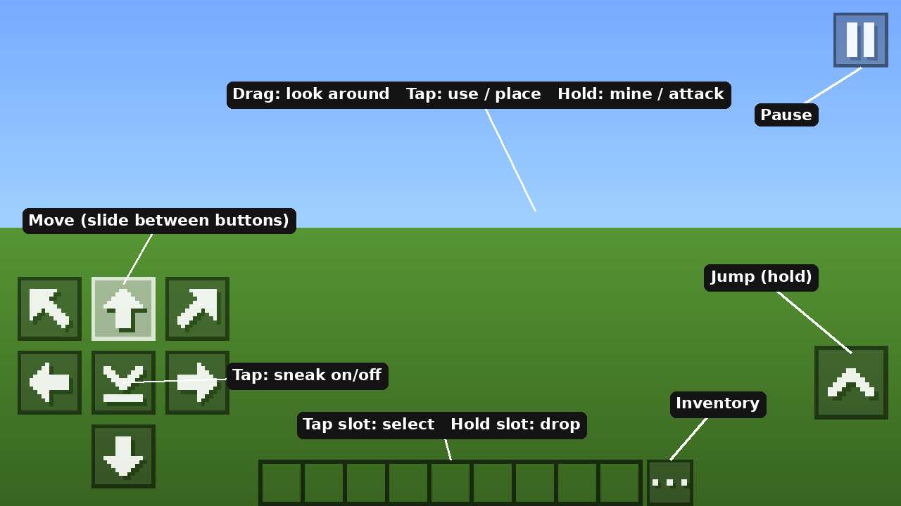

# mcport

**Run Minecraft Alpha 1.1.2_01 natively on Android — no launcher, no JVM on the phone.**

mcport converts your own copy of the desktop game jar into an Android APK. The game's
bytecode is turned into Android dex, and its calls to LWJGL 2, AWT and ImageIO are
redirected to a compatibility layer that draws with EGL + OpenGL ES 1.1. The game's own
code is not changed.

> **Not an official Minecraft product. Not approved by or associated with Mojang or Microsoft.**
> This repository contains **no** Mojang code or assets. You need your own legally obtained
> `a1.1.2_01.jar`; an APK built from it contains Mojang code and is for your personal use only —
> do not distribute it.



**Features**

- Pocket Edition 0.12-style touch controls (D-pad, jump, sneak; split controls like the original game: tap to attack or use/place whatever the crosshair points at, hold to mine)
- The game's original screens, tuned for fingers: tap on release, long-press = right click,
  tap a crafting cell while holding items to place one, snap-to-slot, no accidental drops
- Sound: a software OpenAL mixer (3D position, distance, panning, pitch, streamed music) on Android's AudioTrack —
  bring the sound files from your own launcher install
- Soft keyboard pops up for chat, signs and server addresses
- Fixes two Alpha bugs that matter on phones: random "Comparison method violates its general
  contract!" crashes, and duplicated buttons after leaving the Controls screen
- Desktop test harness: run the same layer on a PC (Xvfb + Mesa) with scripted input and screenshots

**Quick start** (Ubuntu / WSL)

```sh
sudo apt install openjdk-21-jdk android-sdk-platform-23 dalvik-exchange aapt zipalign apksigner libasm-java python3
./build-apk.sh path/to/a1.1.2_01.jar minecraft-alpha.apk ~/.minecraft   # last argument (sounds) is optional
```

Licensed under the MIT License (mcport code only). Full documentation below is in Traditional Chinese.

---

# mcport：Minecraft Alpha 原生 Android 移植轉接層

把桌面版 Minecraft Alpha 的 jar 直接打包成 Android APK。不需要啟動器，也不需要在手機上跑 JVM：
遊戲的位元碼會轉成 Android 的 dex，原本呼叫的 LWJGL 2、AWT、ImageIO 改接到本專案的轉接層，
畫面由 EGL + OpenGL ES 1.1 繪製。

> **本專案不含任何 Mojang 的程式碼或素材。** 你必須自己準備遊戲 jar；
> 用它打包出來的 APK 含有 Mojang 的程式碼，只能自己使用，不能散布。

目前測試過的版本：**Alpha 1.1.2_01**（`a1.1.2_01.jar`，客戶端）。

---

## 一、準備環境

打包要在 Linux 上進行。Windows 可以用 **WSL（Ubuntu）**，步驟完全相同。
以下以 Ubuntu 24.04 為準：

```sh
sudo apt update
sudo apt install openjdk-21-jdk android-sdk-platform-23 dalvik-exchange \
                 aapt zipalign apksigner libasm-java python3
```

若要跑電腦端測試（第四節），再加裝：

```sh
sudo apt install liblwjgl-java xvfb libgl1-mesa-dri
```

## 二、取得遊戲 jar

用你自己的正版帳號，從官方啟動器下載 Alpha 1.1.2_01，再到
`.minecraft/versions/a1.1.2_01/a1.1.2_01.jar` 複製出來。

## 三、打包 APK

```sh
unzip mcport-source-kit.zip -d mcport
cd mcport
./build-apk.sh ~/a1.1.2_01.jar minecraft-alpha.apk ~/.minecraft
```

第三個參數（音效資料夾）可以省略，省略的話遊戲沒有聲音，詳見下方「音效」。

腳本會依序執行七個步驟：

| 步驟 | 內容 |
|---|---|
| 1 | `tools/Remap.java` 把 jar 裡的 `org.lwjgl`、`java.awt`、`javax.imageio`、`javax.sound`、`java.applet` 引用改成 `mcshim.*` |
| 2 | 以 Android API 23 為基準編譯轉接層 |
| 3 | `tools/Check.java` 檢查遊戲用到的每個類別、方法、欄位在轉接層裡都存在（應顯示 `OK`） |
| 4 | 編譯 Android 端程式（Activity、觸控、EGL） |
| 5 | `dx` 轉成 `classes.dex` |
| 6 | `aapt` 打包；遊戲的圖片等資源放在 APK 根目錄；有給音效資料夾的話，音效放進 `assets/mcres/` |
| 7 | `zipalign` 對齊，再用自動產生的 `build/debug.keystore` 簽名 |

第一次打包會自動產生簽名金鑰並存在 `build/debug.keystore`。
**以後更新 APK 要用同一把金鑰**，否則手機會拒絕覆蓋安裝，只能先移除舊版（會刪除存檔）。

### 安裝到手機

把 APK 傳到手機上開啟，允許「安裝未知來源的應用程式」即可。也可以用 adb：

```sh
adb install -r minecraft-alpha.apk
```

需求：Android 5.0 以上，支援 OpenGL ES 1.1（幾乎所有手機都支援）。

### 音效

音效檔不在遊戲 jar 裡（當年是另外從已關閉的伺服器下載），而且同樣屬於 Mojang，所以本專案不附帶。取得方式：

1. 用官方啟動器**實際啟動一次** Alpha 1.1.2_01，啟動器會下載舊版音效
2. 打包時把 `.minecraft` 資料夾當第三個參數：`./build-apk.sh 遊戲.jar 輸出.apk ~/.minecraft`

腳本會自動在裡面找 `resources/`（舊版啟動器）或 `assets/`（新版啟動器，依 `indexes/pre-1.6.json` 還原檔名），
只收集 `sound/`、`newsound/`、`music/`、`newmusic/`、`streaming/` 底下的音效。
App 第一次開啟時會把音效複製到遊戲資料夾，畫面會顯示 `Installing sounds... %`，之後就不會再複製。

也可以不打包，直接把音效資料夾複製到手機的 `Android/data/io.github.mcport.alpha/files/.minecraft/resources/`。

設定裡的 Music、Sound 滑桿可以調音量；App 切到背景時聲音會自動暫停。

**背景音樂：**放在 `music/`（例如 `calm1.ogg`、`calm2.ogg`、`calm3.ogg`）。原版要隨機等 0～10 分鐘才播第一首，
手機上常常還沒聽到就關掉了，所以每次開遊戲的第一首改成 30～90 秒內開始，之後照原版的間隔。

### 存檔位置

`Android/data/io.github.mcport.alpha/files/.minecraft/saves/`

移除 App 會一併刪除存檔，移除前請先備份。

## 四、電腦端測試（不用手機）

轉接層也能接到電腦的 OpenGL 上執行，用腳本操作遊戲並截圖，方便修改後快速驗證：

```sh
./run-desktop-test.sh ~/a1.1.2_01.jar
# 截圖會存在 shots/
```

也可以自訂操作腳本（用分號分隔）：

```sh
./run-desktop-test.sh ~/a1.1.2_01.jar "wait 60; click 427 236; wait 10; click 427 100; wait 200; look 300 0; wait 30; shot shots/a.png"
```

| 指令 | 作用 |
|---|---|
| `wait N` | 等 N 個畫格 |
| `sleep MS` | 等 MS 毫秒 |
| `shot 檔名.png` | 截圖 |
| `click X Y` | 在視窗座標（左上為原點，視窗 854×480）點左鍵 |
| `key K` / `hold K` / `release K` | 按一下／按住／放開 LWJGL 鍵碼 K（例：17=W、57=空白、23=I、1=Esc） |
| `look DX DY` | 轉動視角（滑鼠位移量） |
| `mdown B` / `mup B` | 按住／放開滑鼠鍵（0=左、1=右） |
| `give ID 數量` | 把物品直接放進背包（例：`give 17 4` 給 4 個原木） |
| `counts` / `dump` / `screen` | 印出背包數量／所有配方／目前開的介面 |
| `closebtn` | 印出關閉按鈕的位置 |
| `kind` | 印出目前畫面類型（0 無、1 一般、2 打字、3 背包類） |
| `tapgui X Y [long]` | 模擬手機在背包類畫面點一下（加 long 為長按） |
| `move X Y` | 移動滑鼠游標 |
| `music` | 立刻開始播背景音樂 |
| `pig` / `turn 偏航 俯仰` / `findpig` / `tappig [right\|above 像素]` / `taplook [X Y]` / `pigstat` | 在前方放一隻豬／轉動視角／從畫面找出豬的位置／點豬（或豬旁邊）／模擬手機在某點點一下／印出豬的數值 |

測試世界存在 `build/mchome/`。

聲音可以錄成檔案檢查（電腦端沒有喇叭）：
`MCDESK_JAVA_OPTS="-Dmcdesk.audio=/tmp/audio.raw" ./run-desktop-test.sh 遊戲.jar "..."`，
輸出是 44.1 kHz 立體聲 16-bit 的原始 PCM。測試用的音效可以放在 `build/mchome/.minecraft/resources/`。

## 五、操作方式

### 遊戲中（PE 0.12 風格觸控）

- **十字鍵（左下）：**移動，手指可以在按鈕間滑動；往前走時會出現兩個斜向按鈕
- **十字鍵中間：**蹲下，點一下切換開關
- **右下角 ^：**跳躍，按住會連續跳（離右邊緣稍有距離，拇指比較好按）
- **畫面其他地方：**拖曳轉視角；按住不動＝挖掘（對準畫面中央準心）
  - **點一下（分離控制，同原版／PE「分離控制」）：**一律對準畫面中央準心——準心對著生物＝攻擊，否則＝使用／放置；判定和距離完全用遊戲原本的
- **熱鍵列：**點一下選格子，按住約 0.5 秒丟出物品
- **熱鍵列右邊「⋯」：**打開背包；**右上角 ‖：**暫停；**返回鍵：**Esc

### 原版介面（背包、工作台、箱子、熔爐、選單）

介面都是遊戲原本的樣子，只針對手指操作做了調整：

- **關閉按鈕 ×：**只加在原本沒有返回按鈕的畫面：背包、工作台、箱子、熔爐（× 在視窗右上角外側）和聊天（螢幕右上角）。
  點它等於按 Esc。設定、按鍵設定、告示牌已經有 Done，暫停、載入、死亡、標題畫面也都沒有 ×

- **背包類畫面：**
  - 點一下＝左鍵（拿起／放下整疊），**手指放開時才算**，可以先滑到正確的格子再放開
  - 長按約 0.45 秒＝右鍵（拿一半／放 1 個）；或第一指按著、第二指點一下
  - **拿著材料點合成表任何一格＝只放 1 個**（背包的 2×2 和工作台的 3×3 都適用）
  - 點到格子之間的縫會自動對準最近的格子
  - 拿著東西時點在視窗邊緣附近不會把整疊丟到地上（要丟請點離視窗遠一點的地方）
  - 游標會跟著手指，看得到選中的格子和手上的物品
- **一般選單：**按鈕按下即觸發，滑桿可以直接拖
- **自動鍵盤：**聊天、編輯告示牌、輸入伺服器位址時，手機鍵盤自動跳出，離開後收起
- 支援藍牙／USB 鍵盤

## 六、專案結構

```
.github/workflows/      GitHub Actions：每次推送自動編譯（不含遊戲檔，所以只檢查程式能否編譯）
docs/                   GitHub Pages 介紹頁（index.html）與操作示意圖
LICENSE                 MIT 授權（只涵蓋本專案程式碼）
build-apk.sh            打包腳本
run-desktop-test.sh     電腦端測試腳本
tools/Remap.java        重新導向 jar 的引用（ASM ClassRemapper），在 Minecraft 建構子插入 Hooks.minecraft = this，
                        並把遊戲的排序呼叫換成 SafeSort
tools/Check.java        檢查轉接層是否涵蓋所有引用
tools/collect_sounds.py 從 .minecraft 收集音效打包進 APK（支援 resources/ 和新版 assets/）
shim/src/mcshim/        轉接層（Android 與電腦共用）
  Platform.java         平台介面
  gl/GLBackend.java     GLES 1.1 子集介面
  lwjgl/opengl/GL11.java  用 GLES 1.1 模擬 GL 1.1：矩陣堆疊、display list、GL_QUADS、GL_CLAMP
  lwjgl/...             Display、Keyboard、Mouse、OpenAL（空殼）等
  awt/、imageio/        BufferedImage、Graphics、ImageIO 等子集
  sound/                javax.sound 空殼
  Hooks.java            遊戲執行緒與 UI 之間的橋樑（每幀執行排隊的工作）
  craft/                測試用：讀配方、讀寫背包（電腦端測試指令 give / inv 等）
  ui/GuiTouch.java      原版介面的觸控判斷（合成格放 1 個、對準格子、防誤丟）與 Alpha 按鈕重複錯誤的修正
  audio/                軟體 OpenAL 混音器（位置、距離衰減、左右聲道、音高、音樂串流）
  lwjgl/openal/         遊戲音效庫呼叫的 OpenAL 函式，接到上面的混音器
  SafeSort.java         取代遊戲排序，避免 Alpha 的比較器在新版 Java／Android 上崩潰
android/                Android 端：MainActivity、EGL、AudioTrack 聲音輸出、音效安裝（SoundInstaller）、觸控（TouchOverlay）、
                        自動鍵盤（TextInput）、鍵盤對應、Manifest、圖示
desktop/                電腦端測試平台（真的 LWJGL 2）
```

## 七、已知限制

- 挖掘／攻擊對準畫面中央準心，不是手指點的位置
- 合成格放 1 個、防誤丟等觸控調整依賴 a1.1.2_01 的混淆名稱（`shim/src/mcshim/ui/GuiTouch.java`），找不到時會退回一般點擊
- 多人遊戲沒有測試過
- 目前只驗證過 Alpha 1.1.2_01；其他 Alpha 版本如果用到不同的 API，`Check` 步驟會列出缺少的部分
- 自動鍵盤依賴 a1.1.2_01 的混淆名稱，換版本要更新 `GuiTouch.java`
- 鍵盤只能打遊戲字型支援的英數字與符號，中文會被遊戲忽略

## 八、常見問題

**`[3/7]` 沒有顯示 OK？** 代表這個版本用到了轉接層沒有的 API，訊息會列出缺少的類別或方法，補進 `shim/src/mcshim/` 就行。

**手機上閃退？** App 會在畫面上顯示錯誤報告，可以直接選取複製。也可以用 `adb logcat -s MCPort` 查看紀錄。

**打包時出現 `dx: not found`？** 腳本會自動改用 `/usr/lib/android-sdk/build-tools/debian/dx`，請確認已安裝 `dalvik-exchange`。

**電腦端測試出現 `UnknownHostException`？** 這是正常的：遊戲想下載已經關閉的舊資源伺服器，失敗後會改用本機 `resources/` 裡的音效，不影響遊玩。
